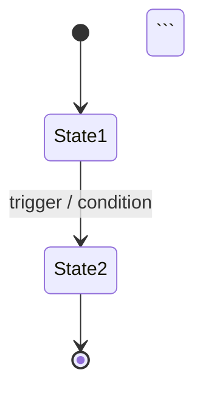

# State Diagram Creation

## Outcome

Produce Mermaid state diagrams that document the lifecycle states, statuses, and valid transitions for domain business objects, stored in `docs/domain-model/object-model/` with a naming convention of `<entity-name>-state-diagram.md`.

## When To Use

- Document the valid states and transitions of a domain object that has a lifecycle (e.g. Individual, FutureEvent, PredictedEvent, PlannedTask, WaitingDelay).
- Clarify which status values are valid for each sub-type.
- Visualize state entry conditions, guards, and transition triggers.
- Provide a single source of truth for state machines referenced in specs and implementation.

Do not use this skill for:
- Database schema design or ER diagrams (use `docs/domain-model/mobile-database-schema.md`).
- Business process flows or user workflows.
- Architecture diagrams or deployment views.

## Location

- All state diagrams live in `docs/domain-model/object-model/`.
- File naming convention: `<kebab-case-entity-name>-state-diagram.md`.
  - Examples: `future-event-state-diagram.md`, `individual-lifecycle-state-diagram.md`

## Format

Each state diagram file MUST follow this structure:

```markdown
# <Entity Name> — State Diagram

## States

| State | Description |
|-------|-------------|
| `<state1>` | <description> |
| `<state2>` | <description> |

## Transitions

| From | To | Trigger | Conditions |
|------|----|---------|------------|
| `<state1>` | `<state2>` | `<event>` | `<condition>` |

## Diagram



## Conventions

- Use Mermaid `stateDiagram-v2` syntax.
- Initial state is `[*]`.
- Final/terminal state is `[*]` (or omit if the object can be deleted).
- Label transitions with the trigger event and optional guard condition using the format: `trigger [condition]`.
- Every state and transition MUST be traceable to a requirement (REQ-XX.XXX) or a business rule (BR-XXX).
- States are nouns or short noun phrases (e.g. `Pending`, `Realized`, `Aborted`).
- Transitions are past-tense verbs (e.g. `realized`, `aborted`, `elapsed`).
- If a sub-type has its own status enum, create a separate diagram or clearly delineate the sub-type states.

## Procedure

1. **Identify the entity** — Determine which domain object needs a state diagram (e.g. FutureEvent, PredictedEvent, Individual).
2. **Read source docs** — Read the domain model (`docs/domain-model/object-model/business-object-model.md`), relevant specs, and business rules to extract all status fields, valid values, lifecycle rules, and transition triggers.
3. **Inventory states** — List all possible states/statuses the entity can be in. Check for implicit states (e.g. "not yet created", "deleted").
4. **Map transitions** — For each state, identify:
   - Which states can it transition to?
   - What event or trigger causes the transition?
   - What conditions/guards must hold?
5. **Draft the diagram** — Write the Mermaid `stateDiagram-v2` block following the format above.
6. **Present the draft** — Show the proposed diagram to the user for review.
7. **Save the file** — Write to `docs/domain-model/object-model/<entity-name>-state-diagram.md`.

## Resume / interruption

If interrupted, re-read the entity's source docs and continue from the last completed step; the diagram file is the source of truth once saved.

## Completion Checks

- [ ] File exists at `docs/domain-model/object-model/<entity-name>-state-diagram.md`.
- [ ] All states from the domain model and specs are represented.
- [ ] All transitions are labeled with a trigger event.
- [ ] Transitions with conditions include guard expressions.
- [ ] Every state and transition is traceable to a requirement or business rule.
- [ ] The Mermaid syntax is valid (no syntax errors).
- [ ] No implementation code or database schema details are included.

## Output Template

After creation, summarize:

- **Entity**: <entity name>
- **File**: `docs/domain-model/object-model/<entity-name>-state-diagram.md`
- **States**: <list of states>
- **Transitions**: <list of transitions>
- **Source references**: <REQs and BRs used>
