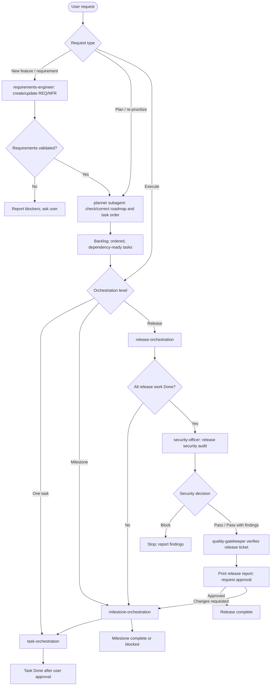
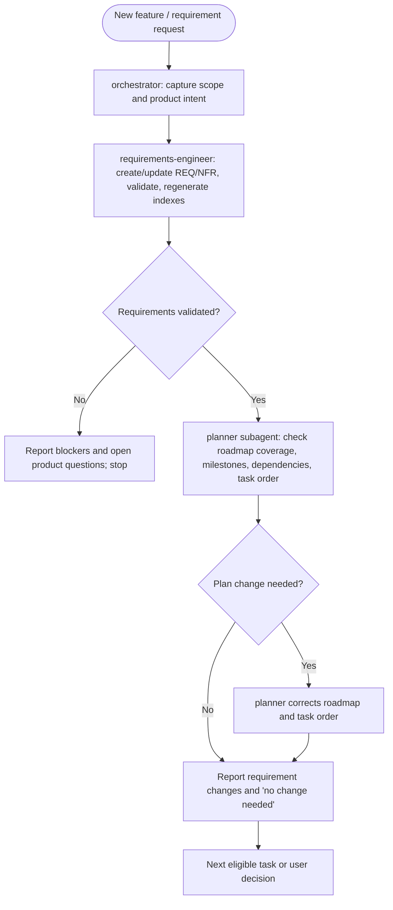
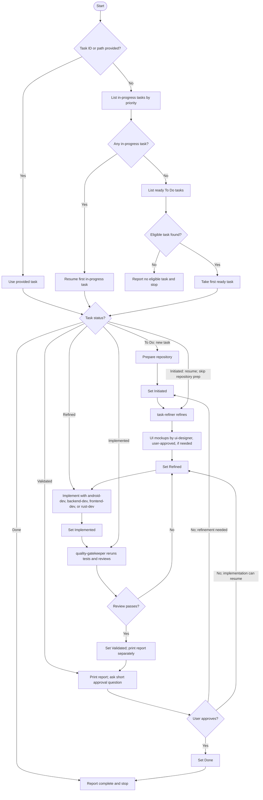
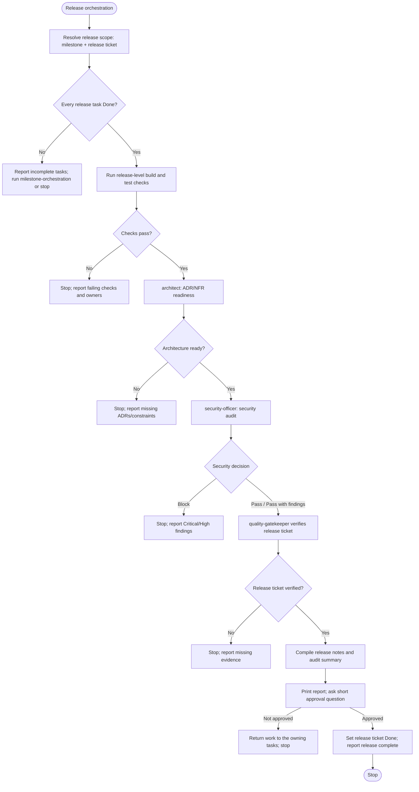

# Orchestrator Workflow

This document describes how the `orchestrator` agent runs software delivery. Backlog reads and status changes use the Backlog.md CLI via the `backlog-md` skill. Agent delegation uses OpenCode's `subagent` tool.

## Ownership

| Concern | Owner |
|---|---|
| Requirement creation, update, validation, traceability | `requirements-engineer` |
| Roadmap, feature priority, milestone/task order, dependencies | `planner` subagent, launched by `orchestrator` |
| Task, milestone, and release execution; status transitions; approval requests | `orchestrator` |
| Ticket refinement and feature specification | `task-refiner` |
| Domain model artifacts (state diagrams, attribute lists, process diagrams) | `domain-modeler` |
| UI mockups | `ui-designer` |
| Implementation | `android-dev`, `backend-dev`, `frontend-dev`, `rust-dev` |
| Quality review | `quality-gatekeeper` |
| End-of-release security audit | `security-officer` |

The orchestrator is the primary entry point. It executes the plan and delegates planning or plan changes to the `planner` subagent; it does not plan itself. It is read-only with respect to project files: it never edits source, docs, requirements, or backlog files directly and never runs repository-modifying commands. Its only writes are backlog status transitions and evidence recording through the Backlog.md CLI.

## End-to-end flow



## New feature or requirement intake

This flow is mandatory whenever the user requests a new feature, a new requirement, or a change to an existing requirement.



Rules:

- Never send a new feature or requirement directly to `planner`.
- `requirements-engineer` owns requirement files, validation, traceability, and index regeneration.
- `planner` owns roadmap and task-order corrections; it reports `no change needed` when the existing plan remains valid.
- Do not start implementation until requirements are validated and the plan is checked.
- If the change affects an in-progress task, pause and ask the user before reordering or re-scoping it.
- Open product decisions stop the flow; do not guess requirements.

## Planning workflow

The orchestrator launches the `planner` subagent when the user asks to:

- create or update the roadmap and feature order;
- change feature priority;
- create or reorder milestones and tasks;
- repair dependencies or validate the dependency graph;
- check and correct the roadmap/task order after `requirements-engineer` reports changed requirements;
- initialize project structure.

The planner works through the Backlog.md CLI and returns the roadmap, milestone plan, task order, dependency validation, issues, and open questions. The orchestrator reports that result to the user and continues with execution only when the plan is actionable.

For a new project, the planner includes early bootstrap tasks (domain modeling: context map and business object model, delegated to `domain-modeler`; technical-stack definition, delegated to `architect`) before feature tickets.

If execution reveals a plan defect (missing dependency, wrong order, missing milestone scope, priority conflict), the orchestrator pauses and delegates a plan repair to the `planner` subagent.

For a new feature or requirement, the orchestrator follows the intake flow above: `requirements-engineer` first, then `planner` to check and correct the plan. The planner must report `no change needed` when the existing plan remains valid.

## Task workflow

The orchestrator loads `task-orchestration` and follows its procedure. The workflow below is the user-facing summary.

### Resume and task selection

- If a task ID/path is supplied, orchestrate that task.
- Otherwise, first run `backlog task list --status "Initiated,Refined,Implemented,Validated" --sort priority --plain` and resume the first (highest-priority) in-progress task.
- If no task is in progress, run `backlog task list --ready --plain` and take the first returned item. Do not reorder the list or ask the user to pick among candidates.
- On resume, read the selected task status and skip completed phases. **Repository preparation is only for a new `To Do` task; never run it when resuming `Initiated` or later.**



### Task steps

1. **Resolve task.** Follow the selection rules above. `backlog task` is the Backlog.md CLI command for task operations; it does not launch agents.
2. **Prepare repository (new tasks only).** For `To Do`, inspect the working tree and prepare the task branch using git (status, checkout `main`, pull, create `task/<task-id>` if it does not already exist). Reuse an existing branch and preserve existing changes rather than recreating them. Never commit, stash, discard, or otherwise alter uncommitted changes without explicit user approval. If git operations are denied or fail, stop and ask the user to prepare the branch and working tree; never bypass the policy. For any resumed status (`Initiated` or later), skip repository preparation entirely and preserve the current branch and changes.
3. **Refine.** Delegate to `task-refiner`; set status to `Refined` when complete. Skip if already `Refined` or later. If UI design is needed, delegate to `ui-designer` and obtain explicit user approval for every referenced `MOCK-XXXX` before `Refined`.
4. **Implement.** Delegate units to `android-dev`, `backend-dev`, `frontend-dev`, or `rust-dev` according to the unit's goals. Capture each agent's structured evidence response; set status to `Implemented` when complete.
5. **Review.** Delegate to `quality-gatekeeper` using OpenCode's `subagent` tool. It independently reruns relevant tests, verifies the ticket, and returns a per-criterion evidence table. If incomplete, set status to `Refined`, address findings, and review again.
6. **Approve.** A passing review sets status to `Validated`. Print the gatekeeper report and the acceptance-criteria checklist separately, then ask a short approval question. Set status to `Done` only after explicit approval (or automatically in no-validation mode). If changes are requested, use `Initiated` if refinement is needed, otherwise `Refined` to resume implementation without repository preparation.
7. **Merge.** Once the task is `Done`, merge its branch into `main` with `--no-ff` (commit any uncommitted changes on `task/<task-id>` first; checkout `main`, pull, `git merge --no-ff task/<task-id>`; leave on `main`). Do not push.

## Milestone workflow

The orchestrator loads `milestone-orchestration`. A milestone is a coherent, usable delivery increment defined by `planner`.

```mermaid
flowchart TD
    MS([Milestone orchestration]) --> RESOLVE["Resolve target milestone"]
    RESOLVE --> LOOP{"Remaining executable work?"}
    LOOP -->|"No"| VERSION["next-version: propose RC version for this milestone"]\n    VERSION --> COMPLETE["Report milestone complete or blocked"]
    LOOP -->|"Yes"| ACTIVE{"Any in-progress task in milestone?"}
    ACTIVE -->|"Yes"| RESUME["Resume highest-priority in-progress task"]
    ACTIVE -->|"No"| READY["First ready To Do task in milestone, release ticket excluded"]
    READY --> ELIGIBLE{"Eligible task?"}
    ELIGIBLE -->|"No"| BLOCKED["Report blockers; do not cross milestone"]
    ELIGIBLE -->|"Yes"| TASKORCH["task-orchestration"]
    RESUME --> TASKORCH
    TASKORCH --> OUTCOME{"Task outcome"}
    OUTCOME -->|"Done"| LOOP
    OUTCOME -->|"Blocked / approval pending / review failed"| PAUSE["Pause and report"]
    COMPLETE --> END([Stop])
    BLOCKED --> END
    PAUSE --> END
```

Rules:

- Never take tasks from another milestone.
- Exclude the release ticket (label `release`) from execution and remaining-work counts; it belongs to `release-orchestration`.
- Stop when the milestone has no remaining `To Do` or in-progress executable tasks.
- If incomplete tasks remain but none is dependency-ready, report blockers and stop.
- Pause for every user approval gate; milestone execution does not bypass task approval, unless the user explicitly requested no-validation mode.
- Before declaring a milestone complete, delegate a lightweight architecture-consistency check to `@architect` (contracts, layering, NFR coverage, ADR status); pause if an ADR is missing.
- Before packaging the milestone as an RC, run `next-version` in RC mode to propose the RC version from Done tasks; record it in the milestone report. Do not create tags or modify version files.
- Re-read milestone state after each task.

## Release workflow

The orchestrator loads `release-orchestration`.

**Release definition:** a release is a backlog milestone named `Release <version>` (for example `Release 1.0`) plus a release ticket in that milestone, labelled `release`, that carries the release acceptance criteria. `planner` creates both. If the project uses a different convention, the release scope must be stated explicitly by the user before orchestration starts.



Rules:

- A release cannot start until every included task is `Done`.
- A release cannot complete while the security decision is `Block`.
- `Pass with findings` is allowed only when no unresolved Critical or High finding remains; Medium and Low findings are reported with owners and follow-up tickets.
- The release ticket is verified by `quality-gatekeeper` after the audit, with the audit report as evidence. If the release ticket has no acceptance criteria, state that explicitly and verify its definition of done directly. A verified release ticket is set to `Validated`.
- The release report includes: release scope, completed tasks, test/build results, security decision with severity counts, accepted risks, and open follow-ups.
- The orchestrator records the release audit summary and user approval through the Backlog.md CLI on the release ticket.
- The orchestrator does not create Git tags unless the user explicitly asks and the environment allows it; it reports the recommended tag and command instead.

## Resume and interruption

- Task state lives in the backlog status and the repository branch.
- Milestone state is derived from its tasks; no separate milestone state is stored.
- Release state is derived from its milestone tasks plus the release ticket.
- Re-invoking any orchestration skill reads current state first and resumes from the matching step. Do not recreate branches, discard changes, or restart completed phases.
- Each step is idempotent: check the current status before acting.

## Approval gates

- **Task:** `Done` requires explicit user approval after a passing quality review.
- **Milestone:** each task approval gate applies; milestone completion is reported, not auto-approved.
- **UI mockups:** every referenced `MOCK-XXXX` must be `approved` in the registry before implementation.
- **Release:** completion requires a passing security audit and explicit user approval.
- A passing review or audit is evidence, not approval.
- **No-validation mode:** when the user explicitly asks to implement a whole milestone without validation/approval, task approval gates are bypassed (a passing review sets `Done` automatically) and execution continues; refinement, implementation, quality review, UI mockup approval, security audit, and stop conditions still apply.
- **Task completion merge:** when a task reaches `Done`, merge its branch into `main` with `--no-ff` (commit pending changes first) and leave the repository on `main`. No push is performed.

## Stop conditions

Always stop and report when:

- no eligible task exists;
- the milestone is empty or blocked;
- a new feature or requirement has unresolved requirements or validation gaps;
- a task is blocked on user input or approval;
- quality review fails without a clear fix;
- the security audit returns `Block`;
- a dependency cycle or cross-milestone ordering defect is found;
- the user interrupts or withholds approval.

## Backlog and delegation

- All backlog reads and writes use the Backlog.md CLI via the `backlog-md` skill.
- Subagent launches use OpenCode's `subagent` tool, not the Backlog CLI's `task` command.
- The orchestrator never edits `backlog/` files or project source/docs directly.
- Plan changes (scope, priority, milestone order, dependencies) are routed to `planner`; ticket scope changes are routed to `task-refiner`.
- New features and new or changed requirements are routed to `requirements-engineer` first; `planner` is called only after requirements are validated.

## References

- [task-orchestration skill](../../skills/task-orchestration/SKILL.md)
- [milestone-orchestration skill](../../skills/milestone-orchestration/SKILL.md)
- [release-orchestration skill](../../skills/release-orchestration/SKILL.md)
- [security-audit skill](../../skills/security-audit/SKILL.md)
- [next-version skill](../../skills/next-version/SKILL.md)
