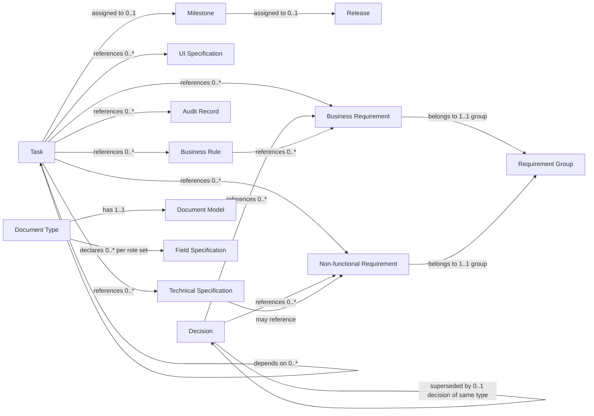

# Papyrus Business Object Model

## Scope

This model covers tasks, milestones, releases, decisions, business requirements, non-functional requirements, requirement groups, glossary terms, UI specifications, technical specifications, audit records, business rules, and document types.

The objects are organized into Backlog Management, Decision Management, Requirements Management, and Documentation Management contexts.

See the companion [Context Map](../context-map.md) for the contexts and their relationships.

## Business object model

## Object descriptions

| Business object                | Bounded context          | Description and documented relationships                                                                                                                                                                                                                                                                                                                            |
| ------------------------------ | ------------------------ | ------------------------------------------------------------------------------------------------------------------------------------------------------------------------------------------------------------------------------------------------------------------------------------------------------------------------------------------------------------------- |
| **Task**                       | Backlog Management       | A tracked unit of work with a generated `TASK`-style ID, status, description, acceptance criteria, labels, and assignee. A task may depend on zero or more other tasks, may be assigned to zero or one milestone, and may reference zero or more business requirements, non-functional requirements, UI specifications, technical specifications, audit records, and business rules. |
| **Milestone**                  | Backlog Management       | A grouping for tasks, identified with an `MS`-style ID. A milestone may be assigned to zero or one release. Milestones have the lifecycle `open -> closed -> archived`: a milestone starts `open`; `papyrus milestone close <id>` sets it to `closed`; `papyrus milestone archive <id>` closes it if still open and then moves its file to `backlog/archive/milestones/`, marking it `archived`; archived milestones are hidden from active listings and there is no restore (REQ-03.001, RE-002).                                                                                                                                                                                                           |
| **Release**                    | Backlog Management       | A release grouping identified with a `REL`-style ID. A release may contain multiple milestones. Releases have the lifecycle `planned -> released`: a release starts `planned` and `papyrus release close <id>` sets it to `released`; `released` means delivery completion, not archiving, and releases are never archived (REQ-03.002).                                                                                                                                                                                                                       |
| **Decision**                   | Decision Management      | A decision record with a configurable decision type (built-in `adr` and `bdr`), status, context, decision, and consequences. A decision may reference zero or more business and non-functional requirements and may be superseded by zero or one decision of the same type. Documented statuses are proposed, accepted, rejected, deprecated, and superseded. |
| **Business Requirement**       | Requirements Management  | A business requirement document belonging to exactly one business-requirement group. It has an ID, title, user story, and description, and shares the document lifecycle `active -> archived`, with no restore (REQ-05.007).                                                                                                                                                                |
| **Non-functional Requirement** | Requirements Management  | A non-functional requirement document belonging to exactly one non-functional-requirement group. It has an ID, title, and description, and shares the document lifecycle `active -> archived`, with no restore (REQ-05.007).                                                                                                                                                                  |
| **Requirement Group**          | Requirements Management  | A grouping record for business requirements or non-functional requirements. Every requirement in a group must have the same type; a group cannot mix the two types.                                                                                                                                                                                           |
| **Glossary Term**              | Documentation Management | A term with an ID, term text, and definition. It shares the document lifecycle `active -> archived`, with no restore (REQ-05.007).                                                                                                                                                                                                                                                               |
| **UI Specification**           | Documentation Management | A UI specification with an ID, title, description, and a view descriptor that names the part of the UI it covers. It shares the document lifecycle `active -> archived`, with no restore (REQ-05.007). |
| **Technical Specification**    | Documentation Management | A managed documentation type with a required title and description. ID format `TECH-xxx` (padded to `id_padding`); stored under `technical/` under `doc_directory`. Lifecycle `active -> archived`; archiving moves the file to the `archived/` subfolder of its type directory and preserves the ID, and there is no restore (REQ-05.007). A task may reference zero or more technical specifications (REQ-02.001); it may reference non-functional requirements (cardinality unspecified; README line 438 / BR-010). Managed via the `tech-spec` command (BR-017). (REQ-05.009, BR-017, BR-010, README) |
| **Audit Record**               | Documentation Management | A document containing the result of an audit with title, type, and content. Default types are `security`, `licence`, and `architecture`; additional types are configurable. It has the document lifecycle `active -> archived`, with no restore (REQ-05.007). Relationships beyond task references are unspecified. |
| **Business Rule**              | Documentation Management | A rule document with an ID, title, description, rationale, applicability, and zero or more references to business requirements. It shares the document lifecycle `active -> archived`, with no restore (REQ-05.007).                                                                                                                                                                             |
| **Document Type**              | Documentation Management | A declaration of one kind of document record, identified by its slug and carrying that kind's document model, ID prefix, folder, status vocabulary, slots, reference visibility, field sets, derived verbs, and presentation facts. Every document record belongs to exactly one document type; a document type has no ID, body, or lifecycle of its own. See [Document Type](#document-type) (REQ-07.001, REQ-07.002, REQ-07.004, ADR-036). |

## Document Type

A document type declares one kind of document record. It is the unit that a command family, the record layer, the browser, and search read; it carries the content model, storage facts, status vocabulary, field sets, verbs, and presentation of the records it declares. A document type is a descriptor, not a record: it has no ID, body, or lifecycle of its own, and its attributes are declaration data rather than record data (REQ-07.002, REQ-07.004).

A document type is a Documentation Management object because it governs the document category. Its addition changes no aggregate boundary: a business requirement and a non-functional requirement stay Requirements Management objects, a task stays a Backlog Management object, and a decision stays a Decision Management object.

### Identity and declaration facts

| Attribute                | Cardinality        | Description                                                                                                                                                                                                                                                                                                                                                                                           |
| ------------------------ | ------------------ | ----------------------------------------------------------------------------------------------------------------------------------------------------------------------------------------------------------------------------------------------------------------------------------------------------------------------------------------------------------------------------------------------------- |
| **slug**                 | `1..1`, unique     | Identity of the document type. It is the `document_types` key, the command name in `papyrus <slug>`, and the type identifier used elsewhere.                                                                                                                                                                                                                                                          |
| **enabled**              | `1..1`             | Whether the type is active. A disabled type has no command and no browser view, and its existing files are untouched.                                                                                                                                                                                                                                                                                  |
| **prefix**               | `1..1`, unique     | The prefix of the type's record IDs. It is unique across all document types, disabled entries included.                                                                                                                                                                                                                                                                                                |
| **directory**            | `1..1`             | The type's folder relative to `doc_directory`; an archived record is stored in the `archived/` subfolder of it. Two enabled types do not share a directory.                                                                                                                                                                                                                                             |
| **statuses**             | `1..*`             | The document statuses a record of the type may carry. The list contains `active` and `archived` exactly once; every other value is a custom status, which is a front-matter value only and never moves a file. A `SingleHtmlMockup` type declares no status list (REQ-07.001).                                                                                                                          |
| **default_status**       | `0..1`             | The status a new record starts at. It is one of the declared statuses and is never `archived`; when absent, a new record starts `active`. A `SingleHtmlMockup` type declares no default status.                                                                                                                                                                                                         |
| **slots**                | `0..*`             | The type's list columns, declared only in the seed entry of the type. A slot key is neither a structural column key (`id`, `title`, `status`, `created`, `updated`, `actions`) nor a reserved field key.                                                                                                                                                                                               |
| **reference_visibility** | `1..1` per role    | `visible` or `hidden`, resolving whether a list row of the type renders its reference list. A single-role type has one value; a grouped type has one value for the group role and one for the member role. Reference visibility affects list rows only.                                                                                                                                                  |
| **presentation facts**   | `1..1`             | `label`, `plural`, `order`, `summary`, `type_alias`, and `api_aliases`, plus each field's `label`, `help`, and sequence position. They supply the list heading, count noun, empty state, inventory note, page title, navigation and sidebar labels, API and legacy URL keys, form labels and hints, view section headings, and required markers.                                                         |

### Document models

A document type has exactly one document model. The model is part of the type's declaration and is never a configuration value.

| Document model        | Records and identity                                                                                                    | Field sets                                                                                                        | Status facts                                                                                                               | Verbs beyond the baseline                                 |
| --------------------- | ----------------------------------------------------------------------------------------------------------------------- | ----------------------------------------------------------------------------------------------------------------- | -------------------------------------------------------------------------------------------------------------------------- | --------------------------------------------------------- |
| **SingleMarkdown**    | One record per plain ID `<PREFIX>-<sequence>`, with a Markdown body.                                                      | One `fields` sequence, which may be empty.                                                                        | Front-matter `status` is `active`, a declared custom status, or `archived`; `default_status` applies at creation.           | `status`.                                                 |
| **GroupedMarkdown**   | A group record with a plain ID and member records with dotted IDs `<PREFIX>-<group-sequence>.<member-sequence>`, each with a Markdown body. | `group.fields` and `member.fields`, each a sequence with independent order; a top-level `fields` is invalid.      | Front-matter `status` on both roles, under the `SingleMarkdown` rules.                                                     | `status`, `create-group`, and the required `--group` on `create`. |
| **SingleHtmlMockup**  | One record per plain ID `<PREFIX>-<sequence>`, with an HTML body.                                                        | No field sequence: `fields` is empty and the record is presented through fixed metadata.                          | Fixed `pending`, `approved`, and `archived` states in the HTML metadata comment; no custom status and no `default_status`.  | `supersede`; no `status`.                                 |

The baseline verbs of every document model are `create`, `list`, `view`, `edit`, `archive`, and `delete`. Verbs are derived from the model and are never declared in configuration.

`SingleMarkdown` is the model of every user-defined document type. `GroupedMarkdown` and `SingleHtmlMockup` belong to seed types only.

### Field sets and roles

A **role** is the position that a record and its field set take under a document model: `single` for a `SingleMarkdown` or `SingleHtmlMockup` record, `group` for a grouped type's group record, and `member` for a grouped type's member record.

A **field specification** declares one content field of a document type. It has a stable `key`, at least one storage location (`heading`, `frontmatter_key`, or both), an `option`, a `label`, a `help`, a `kind`, a `required` flag, and `verbs`. `kind` is `text`, `multiline`, or `list`; `verbs` is a subset of `create` and `edit`. A field with only a `heading` is stored in the body section under that heading, a field with only a `frontmatter_key` is stored as metadata, and a field with both writes both locations. `label`, `help`, and sequence position are presentation facts; sequence position is the field's order in the record body, in the CLI options and help, and in the browser form.

Field keys are unique within a role; the same key may appear in both the group and the member role. A required field is supplied on create and may be changed but not cleared; an optional field may be cleared.

### Invariants

1. **The model is seed-only.** A document type's `DocumentModel` is never declared in configuration: `model`, `title`, `content`, and `id_shape` are not configuration keys. A seed slug takes its model from the seed table and a user-defined slug is `SingleMarkdown`. `GroupedMarkdown` and `SingleHtmlMockup` occur only in the seed, so only `req` and `nfr` are grouped and only `ui-mockup` is an HTML mockup (REQ-07.004, ADR-036 decisions 6 and 31).

2. **Group membership is immutable after creation.** A member record's owning group is fixed when the member is created. A member create requires an existing active group of the same type; an unknown, archived, or other-type group is rejected and nothing is written. No edit changes the membership, archiving or deleting a group changes no member, and no cascade exists in either direction (REQ-07.004, ADR-036 decision 9).

3. **Reserved field keys and general front-matter keys are protected.** The keys `id`, `title`, `status`, `labels`, `references`, `created_date`, `updated_date`, and `group` are reserved: no field declares one as its `key` or its `frontmatter_key`. `labels`, `references`, `created_date`, and `updated_date` are general record metadata, `status` is reserved and read-only, and `group` is engine-owned. The reserved-key rule is enforced when the type is validated and again when a change is applied (REQ-07.002, REQ-05.010, ADR-036 decisions 23 and 24).

4. **Title is fixed and is not a field.** Every document type has a title that is always present, single-line, and non-empty, required on create, and never clearable by an edit. Its key is reserved, no field declares it, and no configuration value renames or redefines it. A `SingleHtmlMockup` applies the same contract to the title in its HTML metadata (REQ-07.003, REQ-07.004, ADR-036 decision 24).

5. **The group link is engine-owned.** A member's `group` front matter is written and maintained only by the document engine. It is not a field, has no CLI option, and is never editable through the type's declaration; a member's group link cannot be changed after creation (REQ-07.004, ADR-036 decisions 9 and 23).

## Lifecycles

| Object family | Lifecycle | Source |
| ------------- | --------- | ------ |
| Documents (business requirements, non-functional requirements, glossary terms, UI specifications, technical specifications, audit records, business rules, use cases, test cases, test reports, and config-defined types) | `active -> archived` via archive; no restore. A type may declare custom statuses that are front-matter values only and never move a file. | REQ-05.007, REQ-07.001 |
| UI mockups | `pending -> approved -> archived`, held in the HTML metadata; supersession archives the superseded mockup | REQ-05.007, REQ-05.008 |
| Milestones | `open -> closed -> archived`: `papyrus milestone close <id>` sets `open` to `closed`; `papyrus milestone archive <id>` closes an open milestone if needed and moves its file to `backlog/archive/milestones/`, marking it `archived`; archived milestones are hidden from active listings; no restore | REQ-03.001, RE-002 |
| Releases | `planned -> released` via `papyrus release close <id>`; never moved or archived | REQ-03.002 |
| Tasks | Configurable statuses plus archive/restore, because task IDs survive that cycle | REQ-01.002, REQ-01.005 |
| Decisions | Fixed Nygard statuses: proposed, accepted, rejected, deprecated, superseded; no archive state and no restore | REQ-04.002 |
| Document types | No lifecycle: a document type is a declaration, not a record, and has no ID, body, or status of its own; the status vocabulary it declares belongs to its records. | REQ-07.001, REQ-07.002 |

A `deprecated/` folder left by an earlier version is not a lifecycle location: it is not read, migrated, or inventoried, and `archived/` is the only inactive location for documents (REQ-05.007, ADR-0022, ADR-0023).

## Documented relationships

| Relationship                                                          | Description                                                        | Cardinality / constraint                                  |
| --------------------------------------------------------------------- | ------------------------------------------------------------------ | --------------------------------------------------------- |
| Task — Milestone                                                      | A task may be assigned to a milestone.                             | `0..1` milestone per task.                                |
| Milestone — Release                                                   | A milestone may be assigned to a release.                          | `0..1` release per milestone.                             |
| Task — Task                                                           | A task may depend on another task.                                  | `0..*` dependencies.                                      |
| Decision — Decision                                                   | A decision may be superseded by a decision of the same type.        | `0..1` superseding decision.                              |
| Decision — Business Requirement / Non-functional Requirement         | A decision may reference either requirement type.                  | `0..*` references of each type.                           |
| Task — Business Requirement / Non-functional Requirement             | A task may reference either requirement type.                      | `0..*` references of each type.                           |
| Task — UI Specification                                               | A task may reference a UI specification.                            | `0..*` references.                                        |
| Task — Technical Specification                                        | A task may reference a technical specification.                     | `0..*` references.                                        |
| Task — Audit Record                                                   | A task may reference an audit record.                               | `0..*` references.                                        |
| Task — Business Rule                                                  | A task may reference a business rule.                               | `0..*` references.                                        |
| Technical Specification — Non-functional Requirement                  | A technical specification may reference a non-functional requirement. | Cardinality is not specified.                             |
| Business Requirement / Non-functional Requirement — Requirement Group | Each requirement belongs to a same-type requirement group.          | `1..1` group per requirement.                             |
| Business Rule — Business Requirement                                  | A business rule may reference a business requirement.               | `0..*` references.                                        |
| Document Type — Document Model                                        | Each document type has exactly one document model.                  | `1..1`.                                                   |
| Document Type — Field Specification                                   | A document type declares the fields of each of its roles.           | One `fields` sequence, or `0..*` fields in each of `group.fields` and `member.fields`. |
| Document Type — document record                                       | Every document record belongs to exactly one document type and carries that type's general front matter plus its declared field values. | `1..1` type per record; `0..*` records per type.          |

## Open questions

1. **Technical Specification:** What is the cardinality of its references to non-functional requirements? (REQ-05.009, README line 438, BR-010)
2. **Audit Record:** What relationships beyond task references apply to audit records?
