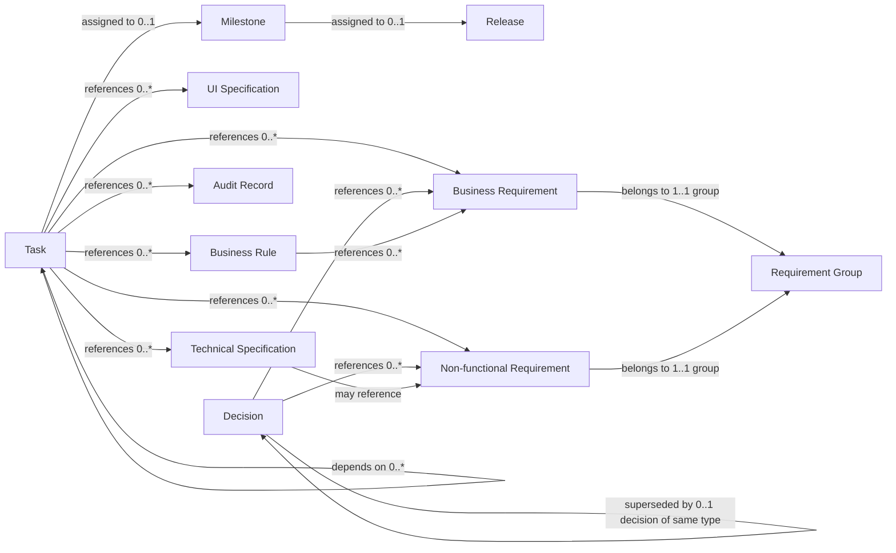

# Papyrus Business Object Model

## Scope

This model covers tasks, milestones, releases, decisions, business requirements, non-functional requirements, requirement groups, glossary terms, UI specifications, technical specifications, audit records, and business rules.

The objects are organized into Backlog Management, Decision Management, Requirements Management, and Documentation Management contexts.

See the companion [Context Map](../context-map.md) for the contexts and their relationships.

## Business object model

## Object descriptions

| Business object                | Bounded context          | Description and documented relationships                                                                                                                                                                                                                                                                                                                            |
| ------------------------------ | ------------------------ | ------------------------------------------------------------------------------------------------------------------------------------------------------------------------------------------------------------------------------------------------------------------------------------------------------------------------------------------------------------------- |
| **Task**                       | Backlog Management       | A tracked unit of work with a generated `TASK`-style ID, status, description, acceptance criteria, labels, and assignee. A task may depend on zero or more other tasks, may be assigned to zero or one milestone, and may reference zero or more business requirements, non-functional requirements, UI specifications, technical specifications, audit records, and business rules. |
| **Milestone**                  | Backlog Management       | A grouping for tasks, identified with an `MS`-style ID. A milestone may be assigned to zero or one release. Milestones have the lifecycle `open -> closed -> archived`: a milestone starts `open`; `papyrus milestone close <id>` sets it to `closed`; `papyrus milestone archive <id>` closes it if still open and then moves its file to `backlog/archive/milestones/`, marking it `archived`; archived milestones are hidden from active listings and there is no restore (REQ-03.001, RE-002).                                                                                                                                                                                                           |
| **Release**                    | Backlog Management       | A release grouping identified with a `REL`-style ID. A release may contain multiple milestones. Releases have the lifecycle `planned -> released`: a release starts `planned` and `papyrus release close <id>` sets it to `released`; `released` means delivery completion, not archiving, and releases are never archived (REQ-03.002).                                                                                                                                                                                                                       |
| **Decision**                   | Decision Management      | A decision record with a configurable decision type (built-in `adr` and `bdr`), status, context, decision, and consequences. A decision may reference zero or more business and non-functional requirements and may be superseded by zero or one decision of the same type. Documented statuses are proposed, accepted, rejected, deprecated, and superseded. |
| **Business Requirement**       | Requirements Management  | A business requirement document belonging to exactly one business-requirement group. It has an ID, title, user story, and description, and shares the document lifecycle `active -> archived`, with no restore (REQ-05.007).                                                                                                                                                                |
| **Non-functional Requirement** | Requirements Management  | A non-functional requirement document belonging to exactly one non-functional-requirement group. It has an ID, title, and description, and shares the document lifecycle `active -> archived`, with no restore (REQ-05.007).                                                                                                                                                                  |
| **Requirement Group**          | Requirements Management  | A grouping record for business requirements or non-functional requirements. Every requirement in a group must have the same type; a group cannot mix the two types.                                                                                                                                                                                           |
| **Glossary Term**              | Documentation Management | A term with an ID, term text, and definition. It shares the document lifecycle `active -> archived`, with no restore (REQ-05.007).                                                                                                                                                                                                                                                               |
| **UI Specification**           | Documentation Management | A UI specification with an ID, title, description, and a view descriptor that names the part of the UI it covers. It shares the document lifecycle `active -> archived`, with no restore (REQ-05.007). |
| **Technical Specification**    | Documentation Management | A managed documentation type with a required title and description. ID format `TECH-xxx` (padded to `id_padding`); stored under `technical/` under `doc_directory`. Lifecycle `active -> archived`; archiving moves the file to the `archived/` subfolder of its type directory and preserves the ID, and there is no restore (REQ-05.007). A task may reference zero or more technical specifications (REQ-02.001); it may reference non-functional requirements (cardinality unspecified; README line 438 / BR-010). Managed via the `tech-spec` command (BR-017). (REQ-05.009, BR-017, BR-010, README) |
| **Audit Record**               | Documentation Management | A document containing the result of an audit with title, type, and content. Default types are `security`, `licence`, and `architecture`; additional types are configurable. It has the document lifecycle `active -> archived`, with no restore (REQ-05.007). Relationships beyond task references are unspecified. |
| **Business Rule**              | Documentation Management | A rule document with an ID, title, description, rationale, applicability, and zero or more references to business requirements. It shares the document lifecycle `active -> archived`, with no restore (REQ-05.007).                                                                                                                                                                             |

## Lifecycles

| Object family | Lifecycle | Source |
| ------------- | --------- | ------ |
| Documents (business requirements, non-functional requirements, glossary terms, UI specifications, technical specifications, audit records, business rules, use cases, test cases, test reports, and config-defined types) | `active -> archived` via archive; no restore. A type may declare custom statuses that are front-matter values only and never move a file. | REQ-05.007, REQ-07.001 |
| UI mockups | `pending -> approved -> archived`, held in the HTML metadata; supersession archives the superseded mockup | REQ-05.007, REQ-05.008 |
| Milestones | `open -> closed -> archived`: `papyrus milestone close <id>` sets `open` to `closed`; `papyrus milestone archive <id>` closes an open milestone if needed and moves its file to `backlog/archive/milestones/`, marking it `archived`; archived milestones are hidden from active listings; no restore | REQ-03.001, RE-002 |
| Releases | `planned -> released` via `papyrus release close <id>`; never moved or archived | REQ-03.002 |
| Tasks | Configurable statuses plus archive/restore, because task IDs survive that cycle | REQ-01.002, REQ-01.005 |
| Decisions | Fixed Nygard statuses: proposed, accepted, rejected, deprecated, superseded; no archive state and no restore | REQ-04.002 |

A `deprecated/` folder left by an earlier version is not a lifecycle location: it is not read, migrated, or inventoried, and `archived/` is the only inactive location for documents (REQ-05.007, ADR-0022, ADR-0023).

## Documented relationships

| Relationship                                                          | Description                                                        | Cardinality / constraint                                  |
| --------------------------------------------------------------------- | ------------------------------------------------------------------ | --------------------------------------------------------- |
| Task — Milestone                                                      | A task may be assigned to a milestone.                             | `0..1` milestone per task.                                |
| Milestone — Release                                                   | A milestone may be assigned to a release.                          | `0..1` release per milestone.                             |
| Task — Task                                                           | A task may depend on another task.                                  | `0..*` dependencies.                                      |
| Decision — Decision                                                   | A decision may be superseded by a decision of the same type.        | `0..1` superseding decision.                              |
| Decision — Business Requirement / Non-functional Requirement         | A decision may reference either requirement type.                  | `0..*` references of each type.                           |
| Task — Business Requirement / Non-functional Requirement             | A task may reference either requirement type.                      | `0..*` references of each type.                           |
| Task — UI Specification                                               | A task may reference a UI specification.                            | `0..*` references.                                        |
| Task — Technical Specification                                        | A task may reference a technical specification.                     | `0..*` references.                                        |
| Task — Audit Record                                                   | A task may reference an audit record.                               | `0..*` references.                                        |
| Task — Business Rule                                                  | A task may reference a business rule.                               | `0..*` references.                                        |
| Technical Specification — Non-functional Requirement                  | A technical specification may reference a non-functional requirement. | Cardinality is not specified.                             |
| Business Requirement / Non-functional Requirement — Requirement Group | Each requirement belongs to a same-type requirement group.          | `1..1` group per requirement.                             |
| Business Rule — Business Requirement                                  | A business rule may reference a business requirement.               | `0..*` references.                                        |

## Open questions

1. **Technical Specification:** What is the cardinality of its references to non-functional requirements? (REQ-05.009, README line 438, BR-010)
2. **Audit Record:** What relationships beyond task references apply to audit records?
