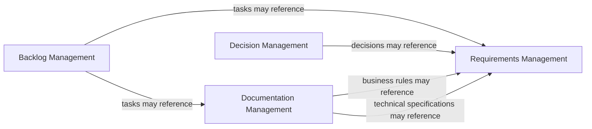

# Context Map

This context map groups the Papyrus business objects documented in the [Business Object Model](object-model/business-object-model.md) by business capability and shows their inter-context relationships.

## Context Descriptions

### Backlog Management

Manages tasks, milestones, and releases. Tasks may depend on other tasks, may be assigned to a milestone, and may reference requirements, UI specifications, technical specifications, audit records, and business rules.

### Decision Management

Manages decisions with a decision type, status, context, decision, consequences, and optional superseding-decision reference. Decisions may reference business and non-functional requirements.

### Requirements Management

Manages business requirements, non-functional requirements, and their type-specific requirement groups. Each requirement belongs to exactly one group, and a group contains requirements of one type.

### Documentation Management

Manages glossary terms, UI specifications, technical specifications, audit records, and business rules. Technical specifications are a recognized documentation type (REQ-05.009) and may reference non-functional requirements; their attributes, lifecycle, ID format, prefix, storage directory, and command behavior are unspecified (REQ-05.009).
