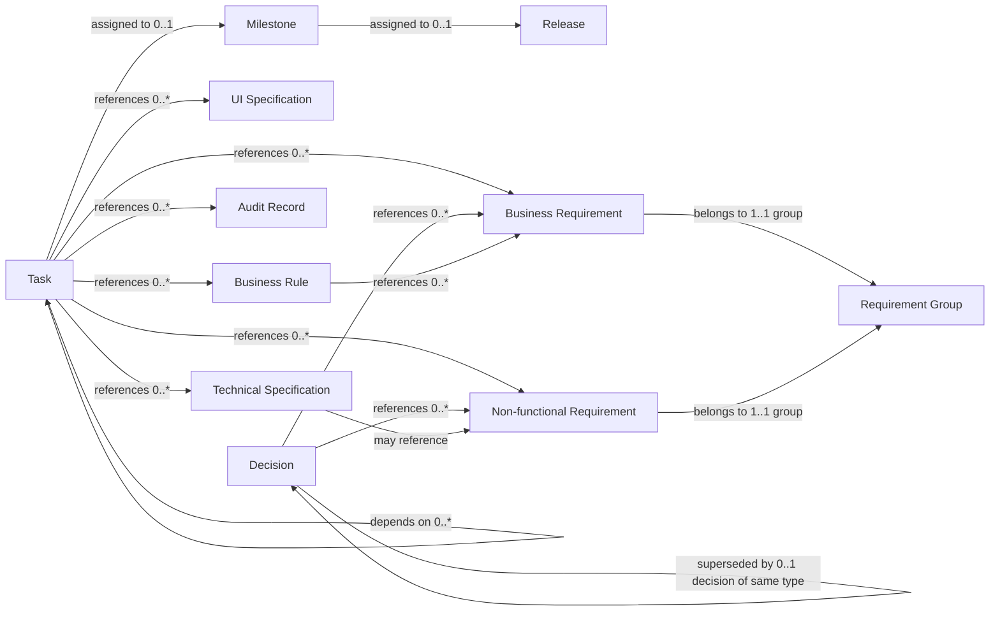

# Papyrus Business Object Model

## Scope

This model covers tasks, milestones, releases, decisions, business requirements, non-functional requirements, requirement groups, glossary terms, UI specifications, technical specifications, audit records, and business rules.

The objects are organized into Backlog Management, Decision Management, Requirements Management, and Documentation Management contexts.

See the companion [Context Map](../context-map.md) for the contexts and their relationships.

## Business object model

## Object descriptions

| Business object                | Bounded context          | Description and documented relationships                                                                                                                                                                                                                                                                                                                            |
| ------------------------------ | ------------------------ | ------------------------------------------------------------------------------------------------------------------------------------------------------------------------------------------------------------------------------------------------------------------------------------------------------------------------------------------------------------------- |
| **Task**                       | Backlog Management       | A tracked unit of work with a generated `TASK`-style ID, status, description, acceptance criteria, labels, and assignee. A task may depend on zero or more other tasks, may be assigned to zero or one milestone, and may reference zero or more business requirements, non-functional requirements, UI specifications, technical specifications, audit records, and business rules. |
| **Milestone**                  | Backlog Management       | A grouping for tasks, identified with an `MS`-style ID. A milestone may be assigned to zero or one release. Milestones have an active/archived lifecycle.                                                                                                                                                                                                           |
| **Release**                    | Backlog Management       | A release grouping identified with a `REL`-style ID. A release may contain multiple milestones. Releases have an active or released lifecycle.                                                                                                                                                                                                                       |
| **Decision**                   | Decision Management      | A decision record with a configurable decision type (built-in `adr` and `bdr`), status, context, decision, and consequences. A decision may reference zero or more business and non-functional requirements and may be superseded by zero or one decision of the same type. Documented statuses are proposed, accepted, rejected, deprecated, and superseded. |
| **Business Requirement**       | Requirements Management  | A business requirement document belonging to exactly one business-requirement group. It has an ID, title, user story, and description, and shares the document lifecycle: active or deprecated.                                                                                                                                                                |
| **Non-functional Requirement** | Requirements Management  | A non-functional requirement document belonging to exactly one non-functional-requirement group. It has an ID, title, and description, and shares the document lifecycle: active or deprecated.                                                                                                                                                                  |
| **Requirement Group**          | Requirements Management  | A grouping record for business requirements or non-functional requirements. Every requirement in a group must have the same type; a group cannot mix the two types.                                                                                                                                                                                           |
| **Glossary Term**              | Documentation Management | A term with an ID, term text, and definition. It shares the document lifecycle: active or deprecated.                                                                                                                                                                                                                                                               |
| **UI Specification**           | Documentation Management | A UI specification with an ID, title, description, and a view descriptor that names the part of the UI it covers. It shares the document lifecycle: active or deprecated. |
| **Technical Specification**    | Documentation Management | A managed documentation type with a required title and description. ID format `TECH-xxx` (padded to `id_padding`); stored under `technical/` under `doc_directory`. Lifecycle active -> deprecated (deprecate/restore preserve the ID). A task may reference zero or more technical specifications (REQ-02.001); it may reference non-functional requirements (cardinality unspecified; README line 438 / BR-010). Managed via the `tech-spec` command (BR-017). (REQ-05.009, BR-017, BR-010, README) |
| **Audit Record**               | Documentation Management | A document containing the result of an audit with title, type, and content. Default types are `security`, `licence`, and `architecture`; additional types are configurable. It has an active/deprecated lifecycle. Relationships beyond task references are unspecified. |
| **Business Rule**              | Documentation Management | A rule document with an ID, title, description, rationale, applicability, and zero or more references to business requirements. It shares the document lifecycle: active or deprecated.                                                                                                                                                                             |

## Documented relationships

| Relationship                                                          | Description                                                        | Cardinality / constraint                                  |
| --------------------------------------------------------------------- | ------------------------------------------------------------------ | --------------------------------------------------------- |
| Task — Milestone                                                      | A task may be assigned to a milestone.                             | `0..1` milestone per task.                                |
| Milestone — Release                                                   | A milestone may be assigned to a release.                          | `0..1` release per milestone.                             |
| Task — Task                                                           | A task may depend on another task.                                  | `0..*` dependencies.                                      |
| Decision — Decision                                                   | A decision may be superseded by a decision of the same type.        | `0..1` superseding decision.                              |
| Decision — Business Requirement / Non-functional Requirement         | A decision may reference either requirement type.                  | `0..*` references of each type.                           |
| Task — Business Requirement / Non-functional Requirement             | A task may reference either requirement type.                      | `0..*` references of each type.                           |
| Task — UI Specification                                               | A task may reference a UI specification.                            | `0..*` references.                                        |
| Task — Technical Specification                                        | A task may reference a technical specification.                     | `0..*` references.                                        |
| Task — Audit Record                                                   | A task may reference an audit record.                               | `0..*` references.                                        |
| Task — Business Rule                                                  | A task may reference a business rule.                               | `0..*` references.                                        |
| Technical Specification — Non-functional Requirement                  | A technical specification may reference a non-functional requirement. | Cardinality is not specified.                             |
| Business Requirement / Non-functional Requirement — Requirement Group | Each requirement belongs to a same-type requirement group.          | `1..1` group per requirement.                             |
| Business Rule — Business Requirement                                  | A business rule may reference a business requirement.               | `0..*` references.                                        |

## Open questions

1. **Technical Specification:** What is the cardinality of its references to non-functional requirements? (REQ-05.009, README line 438, BR-010)
2. **Audit Record:** What relationships beyond task references apply to audit records?
